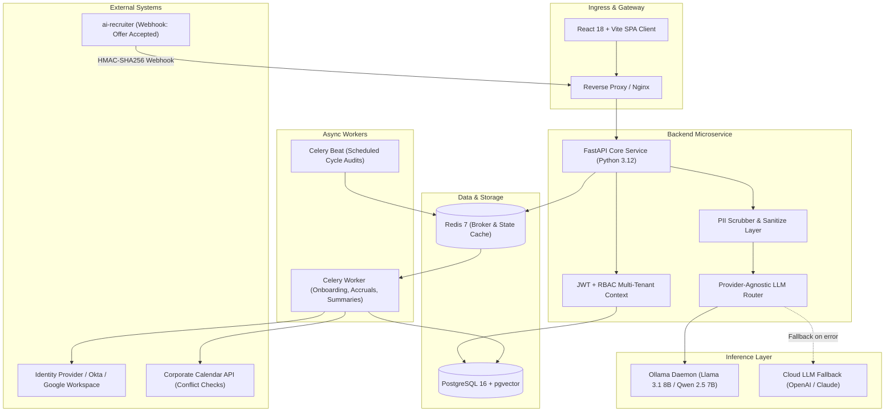

# Architecture Specification & System Design

## 1. System Overview
`ai-hr-platform` is an independently deployable open-source microservice engineered to automate enterprise employee lifecycle events, self-service queries, policy governance, leave management, and continuous performance reviews.



---

## 2. Multi-Tenancy & Data Isolation
- Every core database model contains an `organization_id` foreign key referencing the `organizations` table.
- All incoming requests resolve tenant context from the user's JWT or validated subdomain/API key.
- SQLAlchemy query filters strictly enforce `organization_id == current_user.organization_id`.
- Tenant data cross-contamination is eliminated at both the ORM query level and vector indexing partition filters.

---

## 3. Upstream Integration: `ai-recruiter` Handoff Webhook
When a candidate accepts an offer letter in `ai-recruiter`, the recruitment engine dispatches a cryptographically signed HMAC-SHA256 webhook payload to:
`POST /api/v1/webhooks/recruiter/offer-accepted`

### Payload Schema:
```json
{
  "event_id": "evt_99f2b842a1",
  "event_type": "candidate.offer_accepted",
  "timestamp": "2026-11-15T10:00:00Z",
  "organization_id": "8a06e984-7546-4ef1-b1e7-2b0e9db69098",
  "candidate": {
    "recruiter_candidate_id": "cand_8829104",
    "first_name": "Elena",
    "last_name": "Rostova",
    "email": "elena.rostova@example.com",
    "phone": "+1-555-019-2834",
    "job_title": "Senior AI Systems Engineer",
    "department": "Platform Engineering",
    "hire_date": "2026-12-01",
    "manager_email": "alex.chen@example.com",
    "employment_type": "FULL_TIME",
    "offer_signed_doc_url": "https://storage.internal/recruiter/offers/elena_offer.pdf"
  }
}
```

### Automated Ingestion Pipeline:
1. **Signature Verification:** Validates `X-Recruiter-Signature: sha256=...` using the tenant's shared webhook secret.
2. **Employee Stub Provisioning:** Creates an employee record in status `ONBOARDING` and generates initial password reset invite tokens.
3. **Onboarding Checklist Generation:** Automatically instantiates standard onboarding tasks (e.g., I-9/W-4 collection, laptop dispatch, corporate email creation, compliance handbook sign-off).
4. **Audit Log:** Dispatches an immutable event to `audit_logs` with all PII masked.

---

## 4. Policy Enforcement & RAG Knowledge Base Architecture
1. **Document Ingestion:** HR administrators upload policy PDFs, Markdown SOPs, or labor guidelines.
2. **Chunking & Redaction:** Texts are chunked (500–1000 tokens with 10% overlap), sanitized of any employee PII, and embedded into vectors.
3. **Dual-Dimension Vector Indexing:** 
   - `embedding_768`: Fast, local open-source inference via Ollama (`nomic-embed-text`, `bge-base-en-v1.5`).
   - `embedding_1536`: High-dimensional cloud/extended inference via OpenAI (`text-embedding-3-small`).
4. **Vector Storage:** Embeddings are written to PostgreSQL using the `pgvector` extension with HNSW indexes for sub-10ms similarity queries scoped to the active dimension.
5. **Context-Grounded Q&A:** Employee queries to the HR self-service chat trigger cosine distance similarity searches restricted by tenant `organization_id`. Retrieved passages are formatted into structured citations before being presented to Ollama.
6. **Policy Acknowledgment:** Tracks compliance signatures with cryptographically signed hashes and timestamped audit receipts.

---

## 5. Identity Provider (IdP) Provisioning Architecture
`ai-hr-platform` ships with a dual-mode identity provisioning subsystem:
1. **Mock Provisioning Adapter (`MockProvisioningAdapter`):**
   - Active by default in local Docker Compose, development, and CI environments.
   - Simulates end-to-end account provisioning, group assignments, and lifecycle transitions without external network dependencies.
2. **Enterprise SCIM 2.0 Adapter (`SCIMProvisioningAdapter`):**
   - Standardized RFC 7643 & RFC 7644 implementation.
   - Directly drives user provisioning, metadata synchronization, and account suspension in Okta, Microsoft Entra ID (Azure AD), OneLogin, and PingFederate.
3. **Google Workspace Adapter (`GoogleWorkspaceProvisioningAdapter`):**
   - Direct integration with Google Admin SDK Directory API v1.
   - Automates primary email creation, org unit placement, temporary passwords, and account deactivation.

---

## 6. Privacy, PII Redaction & Audit Integrity
- **PII Scrubber:** Evaluates all text prompts before submitting to local/remote models. Masks SSNs, credit cards, dates of birth, personal emails, and phone numbers.
- **Audit Logs:** Immutable journal capturing actor ID, timestamp, target entity, event type, and client IP address. PII within changesets is redacted prior to DB persistence.
- **Role-Based Access Control (RBAC):**
  - `SUPER_ADMIN`: Cross-tenant platform administration.
  - `HR_ADMIN`: Full lifecycle management, policy authoring, leave configuration, review oversight.
  - `PEOPLE_MANAGER`: Direct reports directory access, leave approvals, 360 feedback reviews, goal tracking.
  - `EMPLOYEE`: Personal profile, self-service leave requests, peer reviews, handbook Q&A, task completion.
