# Database Schema & Entity Relationship Diagram (ERD)

The `ai-hr-platform` database utilizes PostgreSQL with the `pgvector` extension for semantic indexing of company policies and guidelines. Multi-tenancy is enforced at the schema/query level via `organization_id` foreign keys with cascade policies.

## Entity Relationship Diagram (ERD)

```mermaid
erDiagram
    ORGANIZATIONS ||--o{ EMPLOYEES : "employs"
    ORGANIZATIONS ||--o{ POLICY_DOCUMENTS : "defines"
    ORGANIZATIONS ||--o{ LEAVE_POLICIES : "configures"
    ORGANIZATIONS ||--o{ PERFORMANCE_CYCLES : "runs"
    ORGANIZATIONS ||--o{ AUDIT_LOGS : "records"

    EMPLOYEES ||--o{ EMPLOYEES : "manages"
    EMPLOYEES ||--o{ ONBOARDING_TASKS : "assigned"
    EMPLOYEES ||--o{ POLICY_ACKNOWLEDGMENTS : "signs"
    EMPLOYEES ||--o{ LEAVE_BALANCES : "holds"
    EMPLOYEES ||--o{ LEAVE_REQUESTS : "submits"
    EMPLOYEES ||--o{ GOAL_OKRS : "owns"
    EMPLOYEES ||--o{ REVIEW_FEEDBACKS : "reviews / receives"

    POLICY_DOCUMENTS ||--o{ POLICY_ACKNOWLEDGMENTS : "tracks"
    LEAVE_POLICIES ||--o{ LEAVE_BALANCES : "tracks_balance"
    LEAVE_POLICIES ||--o{ LEAVE_REQUESTS : "governs"
    PERFORMANCE_CYCLES ||--o{ GOAL_OKRS : "contains"
    PERFORMANCE_CYCLES ||--o{ REVIEW_FEEDBACKS : "aggregates"

    ORGANIZATIONS {
        uuid id PK
        string name
        string slug UK
        string domain UK
        boolean is_active
        json settings
        timestamp created_at
        timestamp updated_at
    }

    EMPLOYEES {
        uuid id PK
        uuid organization_id FK
        string email UK
        string hashed_password
        string first_name
        string last_name
        string preferred_name
        string phone_number
        enum role "SUPER_ADMIN | HR_ADMIN | PEOPLE_MANAGER | EMPLOYEE"
        enum status "ONBOARDING | ACTIVE | ON_LEAVE | TERMINATED"
        enum employment_type "FULL_TIME | PART_TIME | CONTRACTOR | INTERN"
        string department
        string job_title
        uuid manager_id FK
        date hire_date
        date termination_date
        json custom_attributes
        timestamp created_at
        timestamp updated_at
    }

    ONBOARDING_TASKS {
        uuid id PK
        uuid organization_id FK
        uuid employee_id FK
        string recruiter_candidate_id
        string offer_acceptance_reference
        string title
        text description
        enum category "DOCUMENTATION | EQUIPMENT | ACCESS_PROVISIONING | TRAINING | COMPLIANCE"
        enum status "PENDING | IN_PROGRESS | COMPLETED | BLOCKED | WAIVED"
        date due_date
        timestamp completed_at
        string assigned_to_role
        string document_url
        json external_system_payload
        timestamp created_at
        timestamp updated_at
    }

    POLICY_DOCUMENTS {
        uuid id PK
        uuid organization_id FK
        string title
        string category
        string version
        text content
        int chunk_index
        int total_chunks
        vector embedding_768 "768-dim pgvector (Ollama nomic-embed-text / bge-base)"
        vector embedding_1536 "1536-dim pgvector (OpenAI text-embedding-3-small)"
        string embedding_model
        int active_dimension
        boolean is_active
        boolean requires_acknowledgment
        string source_file_url
        timestamp created_at
        timestamp updated_at
    }

    POLICY_ACKNOWLEDGMENTS {
        uuid id PK
        uuid policy_id FK
        uuid employee_id FK
        timestamp acknowledged_at
        string signature_hash
        string ip_address
        timestamp created_at
        timestamp updated_at
    }

    LEAVE_POLICIES {
        uuid id PK
        uuid organization_id FK
        string name
        enum leave_type "PTO | SICK | PARENTAL | BEREAVEMENT | UNPAID"
        float annual_days_allowed
        float accrual_rate_per_month
        float max_carryover_days
        boolean requires_approval
        boolean is_active
        timestamp created_at
        timestamp updated_at
    }

    LEAVE_BALANCES {
        uuid id PK
        uuid employee_id FK
        uuid policy_id FK
        int year
        float accrued_days
        float used_days
        float carried_over_days
        timestamp created_at
        timestamp updated_at
    }

    LEAVE_REQUESTS {
        uuid id PK
        uuid organization_id FK
        uuid employee_id FK
        uuid policy_id FK
        uuid approver_id FK
        date start_date
        date end_date
        float total_days
        text reason
        enum status "PENDING | APPROVED | REJECTED | CANCELLED"
        text decision_reason
        boolean calendar_conflict_flag
        timestamp created_at
        timestamp updated_at
    }

    PERFORMANCE_CYCLES {
        uuid id PK
        uuid organization_id FK
        string title
        date start_date
        date end_date
        enum status "UPCOMING | ACTIVE | EVALUATION | CLOSED"
        json rubric_config
        timestamp created_at
        timestamp updated_at
    }

    GOAL_OKRS {
        uuid id PK
        uuid organization_id FK
        uuid cycle_id FK
        uuid employee_id FK
        string title
        text description
        json key_results
        float progress_percentage
        enum status "NOT_STARTED | IN_PROGRESS | ACHIEVED | EXCEEDED | MISSED"
        timestamp created_at
        timestamp updated_at
    }

    REVIEW_FEEDBACKS {
        uuid id PK
        uuid organization_id FK
        uuid cycle_id FK
        uuid reviewee_id FK
        uuid reviewer_id FK
        enum relationship "SELF | MANAGER | PEER | DIRECT_REPORT"
        json ratings
        text qualitative_feedback
        text ai_synthesized_summary
        boolean is_submitted
        timestamp created_at
        timestamp updated_at
    }

    AUDIT_LOGS {
        uuid id PK
        uuid organization_id FK
        uuid actor_id FK
        string action
        string entity_type
        string entity_id
        json details
        string ip_address
        string user_agent
        boolean pii_redacted
        timestamp created_at
        timestamp updated_at
    }
```

